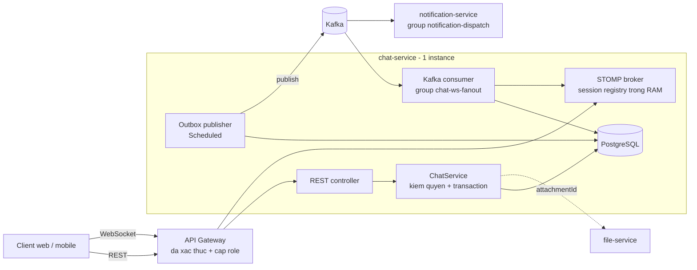
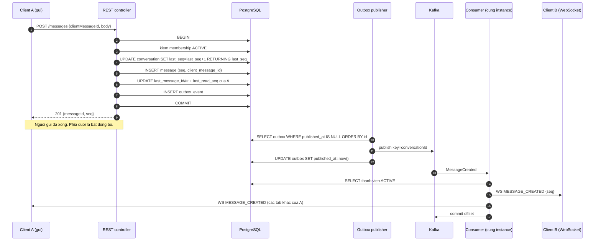
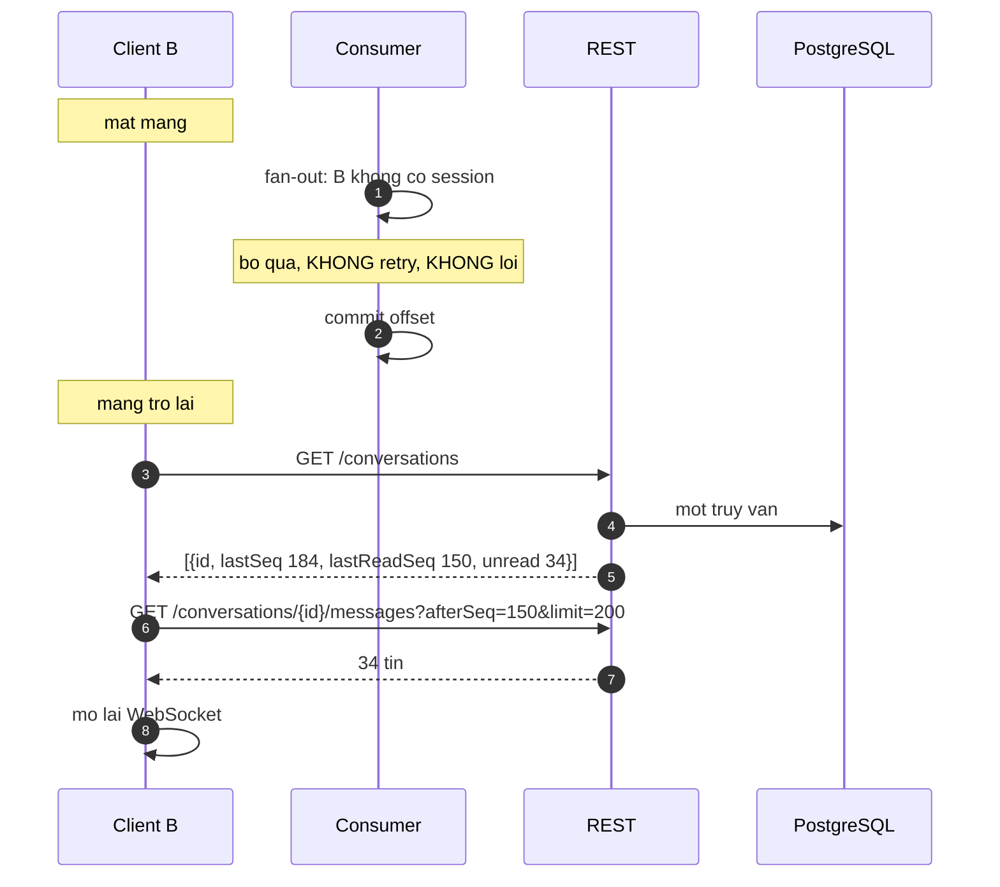
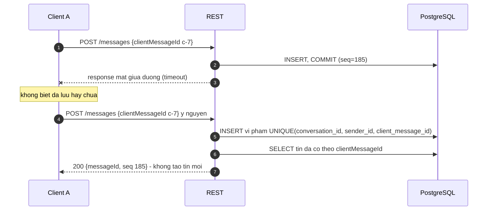
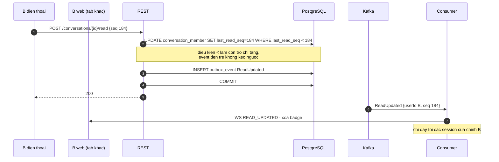
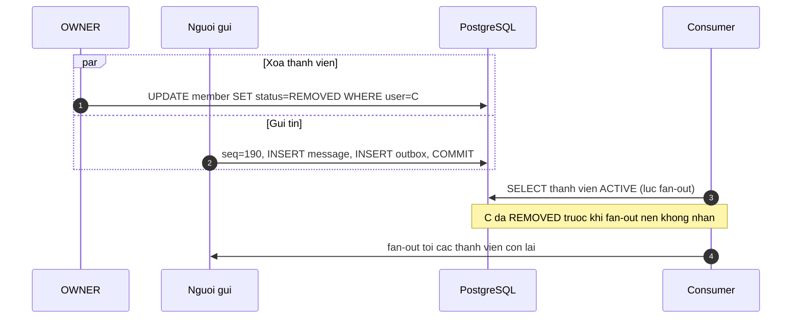

# 02 — Kiến trúc và luồng xử lý

## Hai phương án

### Phương án A — chat-service đơn thân (KHUYẾN NGHỊ)

Một service chứa REST, WebSocket, outbox publisher và Kafka consumer. Một instance.

- **Lợi:** một codebase, một lần deploy, dev tự chạy local bằng docker-compose. Không có vấn đề định tuyến session vì chỉ một JVM giữ toàn bộ WebSocket.
- **Hại:** WebSocket và việc ghi DB dùng chung CPU, heap. Restart là mất toàn bộ kết nối. Muốn scale thì phải scale cả cục.

### Phương án B — chat-service + realtime-service riêng

`chat-service` giữ REST + DB + outbox. `realtime-service` giữ WebSocket + Kafka consumer.

- **Lợi:** scale phần WebSocket độc lập; restart chat-service không rớt kết nối.
- **Hại:** hai service, hai lần deploy, hai bộ cấu hình. Và vấn đề thật: **người nhận đang kết nối vào realtime instance nào?** Từ 2 instance trở lên mà không có Redis thì phải dùng cách "mỗi instance một consumer group" (xem [03](03-kafka.md)) — tức là vẫn phải giải đúng bài đó, chỉ sớm hơn. realtime-service cũng vẫn phải đọc DB để biết danh sách thành viên, nên nó không hề "không có state".

### Chọn A

Đề bài yêu cầu một instance và không mặc định tách realtime. B chỉ đáng làm khi đã **đo** được rằng WebSocket đang cạnh tranh tài nguyên với đường ghi; chưa đo thì tách là tự thêm việc. Thiết kế dưới đây vẫn giữ **ranh giới bên trong code** (package `realtime` không gọi vào repository của message) để sau này tách ra là chuyện di chuyển file, không phải viết lại.

---

## Ranh giới và sở hữu dữ liệu

| Service | Sở hữu | Không bao giờ chạm vào |
|---------|--------|------------------------|
| chat-service | `conversation`, `conversation_member`, `message`, `outbox_event` | Bảng của file-service, notification-service, danh tính user |
| file-service | Byte file, metadata, quyền tải | Bảng chat |
| notification-service | Device token, lịch sử push, quy tắc push | Bảng chat (chỉ gọi API đọc con trỏ đọc) |
| gateway | Token, danh tính, role | — |

chat-service **lưu `userId` như một giá trị**: không có bảng user, không JOIN sang DB nào khác. Khi cần tên và ảnh để render danh sách hội thoại thì client hoặc gateway ghép thêm, hoặc chat-service gọi API user theo lô. Đây là ranh giới hay bị phá nhất — một lần JOIN sang DB của service khác là hết microservice.

## REST dùng cho gì, WebSocket dùng cho gì

| | REST | WebSocket |
|---|------|-----------|
| Gửi tin | **Có** | Không |
| Đánh dấu đã đọc | **Có** | Không |
| Tạo hội thoại, quản lý thành viên | **Có** | Không |
| Đọc lịch sử, danh sách hội thoại, lấy bù tin | **Có** | Không |
| Nhận tin mới | Không | **Có** |
| Nhận "đã đọc" từ thiết bị khác của chính mình | Không | **Có** |
| Nhận thay đổi thành viên | Không | **Có** |

**WebSocket chỉ đi một chiều: server đẩy xuống client.** Client không gửi gì qua WebSocket ngoài heartbeat của STOMP. Đây là quyết định làm đơn giản nhiều nhất trong cả thiết kế.

### Gửi tin bằng REST hay WebSocket? → REST

| | REST `POST /messages` | Gửi qua WebSocket |
|---|---|---|
| Báo lỗi | HTTP status có sẵn: 403, 404, 409, 422 | Phải tự thiết kế khung ack/error + correlationId |
| Chống trùng khi retry | Chuẩn, qua `clientMessageId` + response idempotent | Làm được, nhưng phải tự quản lý state đang chờ ack |
| Test | `curl`, Postman, `MockMvc` | Phải viết client STOMP trong test |
| Rate limit, WAF, log | Gateway làm sẵn theo HTTP | Gateway thường không nhìn vào nội dung frame |
| Độ trễ | Thêm một vòng HTTP (vài ms trong LAN) | Thấp hơn một chút |

Lợi thế duy nhất của WebSocket là vài ms độ trễ, đổi lại là **tự xây lại toàn bộ cơ chế lỗi và retry mà HTTP đã có sẵn**. Với chat giữa người với người, vài ms không ai thấy. → REST. Chi tiết: [ADR-0001](adr/0001-gui-tin-bang-rest.md).

### Kafka giải quyết gì và không giải quyết gì

Nói thẳng: **với một instance, Kafka không cần thiết để đẩy tin tới người nhận.** Lưu DB xong gọi thẳng vào registry session trong cùng JVM là xong. Nếu giữ Kafka thì phải nêu được nó giải quyết việc gì thật, không thì đó là công nghệ dùng cho có.

Kafka **giải quyết**:

1. **notification-service biết có tin mới** mà chat-service không phải gọi HTTP sang nó. Gọi HTTP đồng bộ thì notification chết là gửi tin chậm theo; gọi bằng thread riêng thì mất khi process chết.
2. **Thêm người tiêu thụ mà không sửa chat-service**: audit, thống kê, bot trả lời tự động. Đây là lý do chính ở hệ thống thật.
3. **Một đường duy nhất cho mọi người nhận.** Người gửi và người nhận đều nhận tin qua cùng một con đường (consumer → WebSocket), nên không có hai nhánh code dễ lệch nhau.
4. **Chuẩn bị cho instance thứ hai** mà không phải viết lại phần fan-out.

Kafka **không giải quyết**:

- Thứ tự tin hiện trên màn hình — chỉ `seq` trong DB giải quyết được.
- Việc tin đến được thiết bị. Thiết bị offline thì event trong Kafka vô nghĩa.
- Exactly-once từ DB tới thiết bị. **Không có.** Mọi bên phải chịu được nhận trùng.
- Quyền và kiểm tra nghiệp vụ.
- Mất tin khi process chết giữa commit và publish — đó là việc của **outbox**, không phải Kafka.

### Lưu DB trước rồi phát event, hay nhận lệnh qua Kafka rồi mới lưu?

**Lưu DB trước.** Người gửi cần biết tin đã được chấp nhận và cần `seq` ngay trong response để sắp xếp và hiển thị. Nếu đẩy lệnh vào Kafka rồi trả 202 thì: người gửi không biết mình có quyền gửi không (kiểm quyền bất đồng bộ nghĩa là báo lỗi muộn qua WebSocket), không biết `seq`, và phải tự theo dõi "tin của tôi đã lưu chưa". Phức tạp hơn nhiều và chỉ đáng khi lượng ghi vượt sức DB — không phải trường hợp này.

### Outbox: có, và nó xử lý đúng một lỗi

Trong **cùng** transaction với `INSERT message`, ghi thêm một dòng `outbox_event`. Một job `@Scheduled` quét các dòng chưa publish và đẩy sang Kafka.

**Xử lý:** process chết, hoặc Kafka không với tới, **sau khi** commit DB nhưng **trước khi** publish. Không có outbox thì tin nằm trong DB mà không ai được thông báo — mất realtime và mất push vĩnh viễn, và không có cách nào biết là đã mất.

**Không xử lý:**

- Publish trùng. Kafka nhận rồi mà chưa kịp đánh dấu `published_at` thì lần quét sau publish lại → consumer và client **phải** idempotent.
- Thứ tự tới thiết bị.
- Lỗi logic trong consumer.
- Kafka chết lâu: outbox phình to. Phải giám sát số dòng chưa publish.

Chi tiết: [ADR-0002](adr/0002-outbox-va-fanout-qua-kafka.md).

### API trả thành công cho người gửi khi nào?

Ngay sau khi **transaction commit**. Trả `201` kèm `{messageId, seq, createdAt}`. Không chờ Kafka, không chờ consumer, không chờ người nhận. "Thành công" ở đây nghĩa chính xác là **server đã lưu bền vững và đã cấp số thứ tự** — không nghĩa là có ai đã thấy.

### Đồng bộ và bất đồng bộ

| Đồng bộ (trong request gửi tin) | Bất đồng bộ (sau khi response đã trả) |
|---|---|
| Kiểm membership `ACTIVE` | Publish outbox sang Kafka |
| Cấp `seq` (tăng `conversation.last_seq`) | Consumer fan-out xuống WebSocket |
| `INSERT message` | notification-service quyết định push |
| Cập nhật `last_read_seq` của chính người gửi | Audit, thống kê |
| Cập nhật `conversation.last_message_id`, `last_message_at` | |
| `INSERT outbox_event` | |

Để `last_message_*` trong transaction là có chủ đích: nó làm danh sách hội thoại chỉ cần một truy vấn. Giá phải trả là mọi tin trong một hội thoại ghi vào cùng một dòng `conversation` nên bị tuần tự hóa — đúng điều ta muốn cho `seq`, và ở quy mô này không phải vấn đề.

---

## Các luồng tuần tự

### 1. Gửi và nhận tin 1–1, cả hai đang online

Người gửi nhận tin của chính mình **hai lần**: một lần trong response 201, một lần qua WebSocket. Client phải khớp theo `clientMessageId` / `messageId` để không hiện hai dòng. Đây là cái giá của "một đường duy nhất" và nó **phải** nằm trong hợp đồng với client.

### 2. Gửi tin vào nhóm

Giống luồng 1, chỉ khác ở bước consumer: danh sách thành viên có N người thay vì 2, nên fan-out là `N × số session mỗi người` frame. **Danh sách thành viên đọc từ DB tại thời điểm fan-out, không nhúng vào event** — lý do ở luồng 6.

### 3. Người nhận offline rồi quay lại

Điểm quan trọng: **phục hồi tin bỏ lỡ đi qua REST, không qua Kafka.** Offset đã commit nghĩa là "event đã được xử lý", không nghĩa là "có người nhận được" — nên không bao giờ seek lại offset để phát lại cho một client.

### 4. Người gửi retry vì mất response

Trả `200` thay vì `409` là có chủ đích: client không phải xử lý nhánh lỗi riêng, nó cứ gửi lại tới khi có response. `clientMessageId` **phải** do client sinh (UUID) và giữ nguyên qua mọi lần retry, kể cả sau khi khởi động lại app — nghĩa là nó phải được lưu cùng tin đang chờ gửi ở local.

### 5. Cập nhật đã đọc và đồng bộ nhiều thiết bị

### 6. Thêm / xóa thành viên trong lúc có người đang gửi tin

Chỗ dễ sai nhất, vì có hai thời điểm khác nhau cùng nói về "thành viên":

Quy tắc giải quyết:

- **Quyền gửi** kiểm ở thời điểm transaction gửi tin. Bị xóa rồi thì tin không vào được.
- **Danh sách người nhận** đọc ở thời điểm fan-out, **không** nhúng vào event. Event là bất biến còn danh sách thành viên thì thay đổi; nhúng vào nghĩa là vẫn gửi cho người đã bị xóa khi event bị retry muộn.
- **Người mới thêm** có `join_seq` = `last_seq` lúc thêm, nên tự động nhận mọi tin `seq` lớn hơn và không thấy tin cũ hơn.
- Còn một khe hở **không đóng được bằng thiết kế**: nếu C bị xóa **sau** khi frame đã gửi đi thì C đã thấy tin đó. Không thu hồi được một frame đã ra khỏi server. Chấp nhận, và ghi vào tài liệu — đừng hứa với nghiệp vụ rằng xóa thành viên là tức thì.

Giá của việc đọc thành viên mỗi lần fan-out: một truy vấn cho mỗi tin. Ở mức ~33 tin/s thì không đáng kể. Nếu sau này thành vấn đề thì cache trong RAM theo `conversationId` và xóa cache khi có event `MembershipChanged` — nhưng **chưa cần**.
