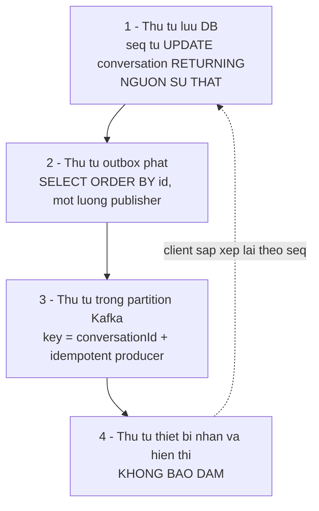

# 03 — Thiết kế Kafka

## Topic

| Topic | Nội dung | Key | Partition | Retention | MVP |
|-------|----------|-----|-----------|-----------|-----|
| `chat.message.created.v1` | Một tin đã được lưu | `conversationId` | 6 | 7 ngày | **Có** |
| `chat.read.updated.v1` | Con trỏ đọc của một user trong một hội thoại đã tăng | `conversationId` | 6 | 1 ngày | **Có** |
| `chat.membership.changed.v1` | Thêm / xóa / rời thành viên | `conversationId` | 6 | 7 ngày | Có (mỏng) |
| `chat.message.created.v1.DLT` | Event thất bại sau khi hết retry | giữ nguyên | 1 | 30 ngày | **Có** |

Ghi `v1` vào tên topic: khi cấu trúc event phải đổi theo cách không tương thích thì tạo `v2` và cho hai consumer chạy song song một thời gian. Đây là cách rẻ nhất để đổi schema khi chưa có schema registry.

Retention 7 ngày **không phải** để phát lại tin cho client — client lấy lại tin qua REST. Nó để điều tra sự cố và để consumer mới (audit, thống kê) đọc được vài ngày gần nhất.

## Cấu trúc event

Nguyên tắc: event mang **sự thật đã xảy ra**, không mang danh sách người nhận, không mang thứ phải tính lại.

```json
{
  "eventId": "9b1f3c4e-7a21-4a0b-8c44-1d2e3f4a5b6c",
  "eventType": "MessageCreated",
  "occurredAt": "2026-10-15T09:21:44.512Z",
  "conversationId": "3f0a7c92-5d31-4e88-9a12-7b6c5d4e3f2a",
  "payload": {
    "messageId": "c7d8e9f0-1234-4567-89ab-cdef01234567",
    "seq": 185,
    "senderId": "u-10427",
    "type": "TEXT",
    "body": "Don hang DH-5512 da ban giao cho shipper",
    "attachmentId": null,
    "clientMessageId": "c-7",
    "createdAt": "2026-10-15T09:21:44.498Z"
  }
}
```

`eventId` là chìa khóa để **consumer** khử trùng. `seq` là chìa khóa để **client** sắp xếp. Hai thứ này khác nhau và không thay thế nhau được.

**Không đưa vào event:** danh sách `recipientIds` (thay đổi theo thời gian — xem [02 luồng 6](02-kien-truc.md)), tên và ảnh người gửi (thuộc service khác), số tin chưa đọc (tính theo từng người đọc).

## Message key

Key = **`conversationId`**.

| Lựa chọn | Hệ quả |
|----------|--------|
| `conversationId` (chọn) | Mọi tin của một hội thoại vào **cùng một partition**, Kafka giữ nguyên thứ tự trong hội thoại. Đúng đơn vị thứ tự mà người dùng cảm nhận được. |
| `userId` (loại) | Một tin có nhiều người nhận nên không có "một" userId. Lấy `senderId` thì hai người trong cùng hội thoại gửi vào hai partition khác nhau, mất thứ tự ngay trong một cuộc chat. |
| `messageId` (loại) | Rải đều, mất hoàn toàn thứ tự. |
| không key (loại) | Round-robin, mất thứ tự. |

Hội thoại là đơn vị thứ tự duy nhất người dùng nhìn thấy, nên nó là key.

## Partition: 6, và lý do không suy từ số user

Số partition **không** liên quan tới 5.000 user. Nó được quyết bởi ba thứ:

1. **Giới hạn song song khi mở rộng.** Số consumer hoạt động trong một group không bao giờ vượt số partition. 6 nghĩa là tối đa 6 instance chia việc — quá đủ cho lộ trình thấy được.
2. **Chia hết cho số instance thực tế.** 6 chia hết cho 1, 2, 3, 6 nên phân bổ đều, không partition nào gánh gấp đôi.
3. **Đổi số partition về sau là phá thứ tự.** Tăng partition làm hàm băm key đổi chỗ, nên tin cũ và tin mới của cùng hội thoại nằm ở hai partition khác nhau — **mất thứ tự vĩnh viễn trong giai đoạn chuyển**. Chọn hơi dư ngay từ đầu rẻ hơn nhiều so với sửa sau.

Về thông lượng thì **1 partition đã đủ**: ~33 tin/s là mức một partition xử lý thừa sức. Chọn 6 là để không phải repartition, không phải vì tải.

## Consumer group

| Group | Service | Topic | Việc làm | Nếu chết thì sao |
|-------|---------|-------|----------|------------------|
| `chat-ws-fanout` | chat-service | cả 3 topic nghiệp vụ | Đẩy xuống WebSocket của các session đang giữ | Mất realtime; tin vẫn trong DB, client lấy qua REST |
| `notification-dispatch` | notification-service | `message.created`, `read.updated` | Chờ 30s, kiểm con trỏ đọc, push nếu chưa đọc | Mất push; không ảnh hưởng chat |
| `chat-audit` (sau) | service riêng | tất cả | Ghi log nghiệp vụ | Không ảnh hưởng gì |

Mỗi group đọc độc lập và có offset riêng. notification chết không làm realtime chậm, và ngược lại — đây chính là thứ Kafka mua được cho ta.

## Commit offset

`enable.auto.commit=false`. Spring Kafka `AckMode.RECORD`: commit **sau khi** xử lý xong từng record.

Hệ quả phải chấp nhận: process chết **sau** khi fan-out xong nhưng **trước** khi commit sẽ xử lý lại sau restart, nên **thiết bị nhận trùng tin**. Đây là at-least-once và là lựa chọn đúng: thà nhận trùng (client khử được) hơn là mất (không ai phát hiện được).

Không bao giờ làm ngược lại (commit trước rồi xử lý): khi đó crash là mất event, mà mất event thì không có cách nào biết.

## Retry, backoff, event lỗi

`DefaultErrorHandler` + `ExponentialBackOff`: 1s → 2s → 4s, tối đa 3 lần (~7s), rồi `DeadLetterPublishingRecoverer` đẩy sang `.DLT`.

Phân loại lỗi — quan trọng hơn con số backoff:

| Loại | Ví dụ | Xử lý |
|------|-------|-------|
| **Không phải lỗi** | Người nhận không có session WebSocket nào | **Bỏ qua, commit luôn.** Offline là trạng thái bình thường. Retry ở đây là sai thiết kế và sẽ nghẽn cả partition chỉ vì một người offline. |
| Lỗi tạm thời | DB timeout khi đọc danh sách thành viên | Retry theo backoff |
| **Lỗi vĩnh viễn** | Event không parse được, `conversationId` không tồn tại, thiếu field | **Vào DLT ngay**, không retry. Retry 3 lần một event hỏng chỉ làm chậm cả partition. |

Lỗi vĩnh viễn khai báo qua `addNotRetryableExceptions` (ví dụ `DeserializationException`, `ConversationNotFoundException`).

Xử lý DLT: cảnh báo khi DLT có bản ghi, người vận hành xem và quyết định — sửa dữ liệu rồi phát lại, hoặc bỏ. **Không** tự động phát lại DLT vòng tròn.

Một partition bị nghẽn vì retry sẽ chặn **mọi hội thoại cùng partition đó**. Đó là lý do phải phân loại lỗi cho đúng, chứ không phải cấu hình retry cho nhiều.

## Idempotency ở ba tầng

Ba tầng giải ba bài khác nhau. Thiếu tầng nào là có bug tầng đó.

| Tầng | Cách làm | Chống được gì | **Không** chống được gì |
|------|----------|---------------|-------------------------|
| **Producer** | `enable.idempotence=true`, `acks=all`, `retries` cao | Kafka tự retry trong **cùng một phiên producer** làm ghi hai lần | Outbox publish lại sau khi process restart — đó là publish mới, producer không biết |
| **Consumer** | Khử trùng theo `eventId`: bảng `processed_event(event_id PK, processed_at)` | Outbox publish trùng; xử lý lại do chưa commit offset | Việc client nhận trùng từ hai nguồn khác nhau |
| **Client** | Khử theo `messageId` (và `clientMessageId` cho tin của chính mình); sắp xếp theo `seq`, không theo thứ tự đến | Mọi trường hợp trùng còn lại | Không gì — đây là lưới chắn cuối |

Với một instance, bảng `processed_event` **có thể bỏ ở MVP**: fan-out chỉ là gửi WebSocket, gửi trùng thì client khử. Nhưng nếu consumer có tác dụng phụ (trừ tiền, ghi audit, gọi API ngoài) thì bảng này **bắt buộc**. Ghi ở đây để lúc đó không phải khảo cổ.

`enable.idempotence=true` chỉ có nghĩa trong phạm vi một producer session. Nó **không** biến hệ thống thành exactly-once.

## Giữ thứ tự: bốn lớp khác nhau



| Lớp | Có bảo đảm? | Bảo đảm bằng gì | Phá vỡ bởi |
|-----|-------------|-----------------|------------|
| **1. Thứ tự lưu DB** | **Có, tuyệt đối** | `UPDATE conversation SET last_seq = last_seq + 1 RETURNING last_seq` trong transaction → khóa dòng → tuần tự hóa mọi tin của hội thoại | Không gì (trong một DB) |
| **2. Thứ tự outbox phát** | Có, nếu làm đúng | `SELECT ... ORDER BY id` và **một luồng publisher duy nhất** | Publisher đa luồng; hai instance cùng quét outbox mà không có khóa |
| **3. Thứ tự trong partition** | Có, với điều kiện | Cùng key + `enable.idempotence=true` (giữ thứ tự cả khi retry) | Đổi số partition; đổi key; `max.in.flight>1` **mà không** bật idempotence |
| **4. Thứ tự thiết bị nhận/hiển thị** | **Không** | — | Retry, reconnect, nhiều session, mạng, client xử lý song song |

Kết luận hành động: **client bắt buộc sắp xếp theo `seq`, không theo thứ tự frame đến.** Và vì `seq` liên tục không hở trong một hội thoại, client phát hiện được mình thiếu tin (nhận `seq=187` khi đang có `185`) và tự gọi `GET ...?afterSeq=185`. Đây là lợi ích chính của số đếm liên tục so với timestamp hay UUID.

Nhắc lại cho rõ: **không có exactly-once từ DB tới thiết bị.** Chuỗi này có bốn chặng (DB → outbox → Kafka → consumer → WebSocket), chặng nào cũng có thể lặp. Thiết kế đúng là at-least-once ở mọi chặng cộng khử trùng ở đầu cuối.

## Cấu hình đề xuất cho một instance

```yaml
spring:
  kafka:
    producer:
      acks: all
      retries: 2147483647
      properties:
        enable.idempotence: true
    consumer:
      group-id: chat-ws-fanout
      enable-auto-commit: false
      auto-offset-reset: latest
      max-poll-records: 50
    listener:
      ack-mode: record
      concurrency: 1
```

`auto-offset-reset: latest` là có chủ đích: khi group này chạy lần đầu hoặc mất offset, **không** được phát lại toàn bộ tin 7 ngày xuống WebSocket của mọi người. Client lấy lịch sử qua REST. Đặt `earliest` là tự tạo ra một cơn bão tin cũ.

`concurrency: 1` đổi lấy sự rõ ràng: một luồng xử lý theo đúng thứ tự partition, và đủ nhanh ở quy mô này. Tăng lên chỉ khi đã đo được là chậm; tăng rồi thì các partition chạy song song nên thứ tự **giữa các hội thoại** không còn — vẫn chấp nhận được, vì thứ tự chỉ cần đúng *trong* một hội thoại.

## Mở rộng nhiều instance khi không có Redis

Bài toán: instance 1 consume được event, nhưng WebSocket của người nhận nằm ở instance 2. Instance 1 không có cách nào đẩy frame qua instance 2. **Chưa triển khai — chỉ phân tích.**

### Cách 1 — mỗi instance một consumer group riêng (khuyến nghị khi tới lúc)

`group.id = chat-ws-fanout-${INSTANCE_ID}`. Mọi instance nhận **mọi** event, mỗi instance chỉ đẩy cho những session nó đang giữ.

- **Lợi:** không cần Redis, không cần broker relay, không cần sticky session. Code fan-out **không đổi một dòng** — đây là lý do nó đáng chọn.
- **Hại:** mỗi instance xử lý toàn bộ lưu lượng (công việc tăng theo số instance); mỗi instance một offset riêng; group cũ phải được dọn khi instance biến mất.
- **Khi nào đủ tốt:** khi phần tốn kém là **giữ kết nối**, không phải xử lý event. Với 5 instance và 33 tin/s thì tổng cộng vẫn chỉ ~165 lần xử lý/s — không đáng kể.

### Cách 2 — sticky session ở load balancer theo userId

Băm `userId` ở gateway để một user luôn vào cùng instance, và đổi key Kafka sang `userId` để consumer tương ứng nhận được.

- **Hại nặng:** đổi key sang `userId` là **mất thứ tự trong hội thoại** (lớp 3 ở trên), và một tin có N người nhận nên vẫn phải phát N bản. Thêm nữa, instance restart là phải rebalance kết nối. Không đáng.

### Cách 3 — dùng PostgreSQL `LISTEN` / `NOTIFY` làm bus nội bộ

Instance nào nhận event thì `NOTIFY`, mọi instance `LISTEN` và đẩy cho session của mình.

- **Hại:** payload giới hạn ~8KB, không bền (ai không nghe lúc đó thì mất), và tạo **con đường thứ hai** song song với Kafka — đúng thứ ta đang tránh. Chỉ hợp khi không có Kafka.

→ Khi cần instance thứ hai thì làm **Cách 1**: thêm biến môi trường `INSTANCE_ID` vào `group-id`, hết. Chuẩn bị duy nhất cần làm từ bây giờ: **không** viết code fan-out dựa trên giả định "tôi là instance duy nhất" (ví dụ đếm tổng số session để báo cáo presence toàn hệ thống).
