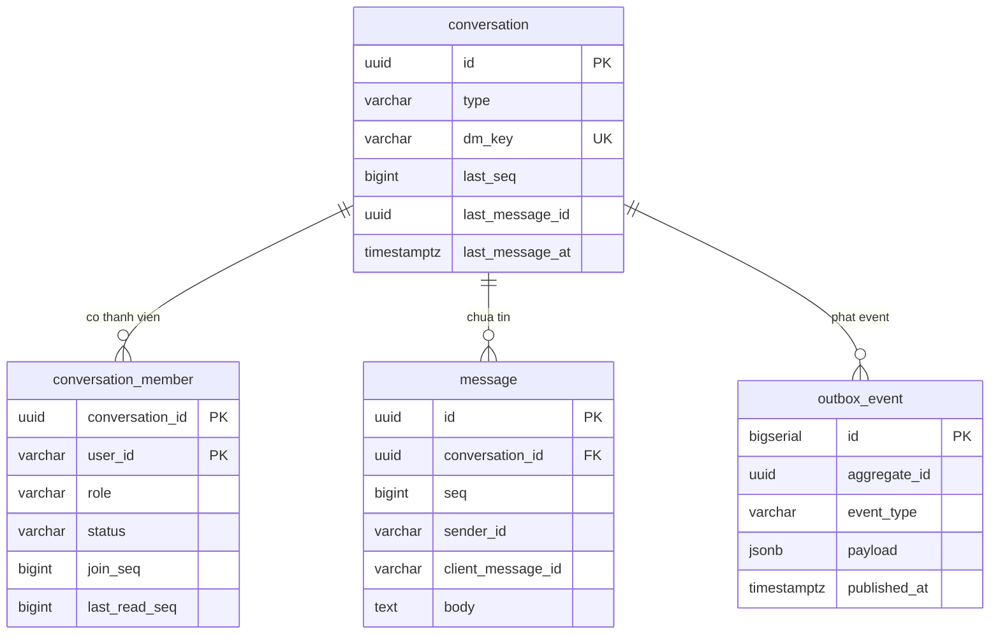

# 04 — Dữ liệu và hợp đồng giao tiếp

Mức thiết kế, chưa phải DDL đầy đủ. Kiểu dữ liệu ghi theo PostgreSQL để không nhập nhằng.

## Bảng

### `conversation`

| Cột | Kiểu | Ghi chú |
|-----|------|---------|
| `id` | `uuid` PK | **UUID v4 ngẫu nhiên**, không dùng số tăng dần — xem mục ID đoán được ở [05](05-rui-ro-va-gioi-han.md) |
| `type` | `varchar(8)` | `DM` hoặc `GROUP` |
| `dm_key` | `varchar(80)` NULL | Chỉ có giá trị khi `type=DM`. Dùng để chống tạo trùng hội thoại 1–1 |
| `title` | `varchar(200)` NULL | Chỉ dùng cho `GROUP` |
| `created_by` | `varchar(64)` | `userId` dạng giá trị, không có FK sang service khác |
| `last_seq` | `bigint NOT NULL DEFAULT 0` | **Bộ đếm cấp số thứ tự tin.** Trái tim của thiết kế |
| `last_message_id` | `uuid` NULL | Để danh sách hội thoại chỉ cần một truy vấn |
| `last_message_at` | `timestamptz` NULL | Sắp xếp danh sách hội thoại |
| `created_at` | `timestamptz NOT NULL` | |

- PK `id`
- `UNIQUE (dm_key)` — Postgres cho phép nhiều `NULL` trong unique index nên nhóm không bị ảnh hưởng
- `INDEX (last_message_at DESC)`

### `conversation_member`

| Cột | Kiểu | Ghi chú |
|-----|------|---------|
| `conversation_id` | `uuid` | |
| `user_id` | `varchar(64)` | |
| `role` | `varchar(8)` | `OWNER` / `MEMBER` |
| `status` | `varchar(8)` | `ACTIVE` / `LEFT` / `REMOVED` |
| `join_seq` | `bigint NOT NULL` | `conversation.last_seq` tại lúc thêm vào → cắt lịch sử trước khi tham gia |
| `last_delivered_seq` | `bigint NOT NULL DEFAULT 0` | Con trỏ **đã nhận**. Chỉ tăng. Thêm ngày 2026-10-15 |
| `last_read_seq` | `bigint NOT NULL DEFAULT 0` | Con trỏ đọc. Chỉ tăng. Luôn `<= last_delivered_seq` (có CHECK) |
| `joined_at` | `timestamptz NOT NULL` | |
| `left_at` | `timestamptz` NULL | |

- PK `(conversation_id, user_id)` — khóa tổ hợp này tự chống thêm trùng thành viên
- `INDEX (user_id, status)` — cho câu "danh sách hội thoại của tôi"

### `message`

| Cột | Kiểu | Ghi chú |
|-----|------|---------|
| `id` | `uuid` PK | UUID v4 |
| `conversation_id` | `uuid NOT NULL` | |
| `seq` | `bigint NOT NULL` | Liên tục, không hở, trong phạm vi một hội thoại |
| `sender_id` | `varchar(64) NOT NULL` | |
| `type` | `varchar(16) NOT NULL` | `TEXT` / `IMAGE` / `FILE` |
| `body` | `text` NULL | NULL khi là file thuần |
| `attachment_id` | `varchar(64)` NULL | Id từ file-service. chat-service không giữ byte |
| `client_message_id` | `varchar(64) NOT NULL` | Do client sinh, dùng cho idempotency |
| `created_at` | `timestamptz NOT NULL` | Thời điểm server, **không** tin thời gian của client |
| `deleted_at` | `timestamptz` NULL | Cho thu hồi mềm sau này |

- PK `id`
- `UNIQUE (conversation_id, seq)` — chốt an toàn: nếu logic cấp `seq` sai thì DB chặn, không âm thầm ghi dữ liệu sai
- `UNIQUE (conversation_id, sender_id, client_message_id)` — chống lưu trùng khi retry
- `INDEX (conversation_id, seq DESC)` — phục vụ **mọi** truy vấn lịch sử và lấy bù

### `outbox_event`

| Cột | Kiểu | Ghi chú |
|-----|------|---------|
| `id` | `bigserial` PK | Số tăng dần — ở đây **cần** thứ tự nên dùng serial, không dùng UUID |
| `aggregate_type` | `varchar(32)` | `CONVERSATION` |
| `aggregate_id` | `uuid` | `conversationId`, dùng luôn làm Kafka key |
| `event_type` | `varchar(40)` | `MessageCreated` / `ReadUpdated` / `MembershipChanged` |
| `payload` | `jsonb NOT NULL` | Event hoàn chỉnh, sẵn sàng publish |
| `created_at` | `timestamptz NOT NULL` | |
| `published_at` | `timestamptz` NULL | NULL = chưa publish |
| `attempts` | `int NOT NULL DEFAULT 0` | Phát hiện dòng publish hoài không được |

- `INDEX (id) WHERE published_at IS NULL` — **partial index**: chỉ chứa dòng chưa publish nên luôn nhỏ dù bảng có hàng triệu dòng. Index toàn bảng sẽ làm publisher chậm dần theo thời gian.
- Dọn dẹp: job xóa dòng `published_at < now() - 7 days`. Không dọn thì bảng phình vô hạn.

### Quan hệ



**Không có bảng `user`.** `user_id` là `varchar` chứa id từ hệ thống danh tính. Đây là ranh giới service, cố ý không có FK.

---

## Cấp thứ tự tin: ba lựa chọn, chọn một

Quyết định kỹ thuật quan trọng nhất của toàn bộ thiết kế.

| Cách | Vấn đề |
|------|--------|
| Dùng `created_at` | Hai tin cùng millisecond không phân biệt được; không biết mình có thiếu tin hay không; lệch đồng hồ. **Loại.** |
| `bigserial` toàn cục | Đơn giản, nhưng số nhảy giữa các hội thoại (185 rồi 912) nên client **không** biết nó thiếu tin hay không, và `afterSeq` mất ý nghĩa. **Loại.** |
| **`UPDATE conversation SET last_seq = last_seq + 1 RETURNING last_seq`** | Liên tục, không hở, trong phạm vi hội thoại. **Chọn.** |

Cách đã chọn hoạt động như sau: câu `UPDATE` khóa dòng `conversation` tới hết transaction, nên hai người gửi cùng lúc trong một hội thoại bị **tuần tự hóa** — người thứ hai chờ người thứ nhất commit. Không ai mất tin, không ai trùng số.

- **Giá phải trả:** mọi tin trong một hội thoại ghi tuần tự. Một hội thoại không bao giờ cần hàng nghìn tin/giây, nên đây là cái giá đúng.
- **Lợi ích đổi lại:** client biết chắc nó thiếu tin (nhận 187 khi đang có 185) nên `GET ...?afterSeq=` hoạt động được, và unread chỉ là một phép trừ.
- `UNIQUE (conversation_id, seq)` là lưới an toàn: nếu ai viết code cấp `seq` theo cách khác (ví dụ `SELECT max(seq)+1` — vốn bị race) thì DB chặn ngay thay vì âm thầm sinh dữ liệu sai.

## Transaction boundary

Một transaction cho một lần gửi tin, đúng thứ tự này:

```
BEGIN
  1. SELECT membership (conversation_id, user_id) -> phai ACTIVE, neu khong: rollback, tra 404
  2. UPDATE conversation SET last_seq = last_seq + 1, last_message_at = now()
     WHERE id = ? RETURNING last_seq              -- khoa dong tu day
  3. INSERT INTO message (..., seq = last_seq vua nhan)
     -- neu vi pham UNIQUE(conversation_id, sender_id, client_message_id):
     --   rollback, SELECT tin da co, tra 200 voi tin do
  4. UPDATE conversation SET last_message_id = <id tin vua chen> WHERE id = ?
  5. UPDATE conversation_member SET last_read_seq = <seq>
     WHERE conversation_id = ? AND user_id = <nguoi gui>   -- tin cua minh coi nhu da doc
  6. INSERT INTO outbox_event (payload = event da dung san)
COMMIT
```

Bước 2 đặt trước bước 3 là có lý do: lấy khóa **sớm nhất có thể** để thời gian giữ khóa đúng bằng thời gian cần thiết, và để không bao giờ có hai transaction cùng tin là mình giữ `seq` 185.

Xử lý concurrent:

| Tình huống | Cách giải quyết |
|------------|-----------------|
| Hai người cùng gửi vào một hội thoại | Khóa dòng ở bước 2 tuần tự hóa; người sau chờ rồi nhận `seq` tiếp theo |
| Cùng một người gửi hai tin rất nhanh | Hai transaction, tuần tự theo cùng cơ chế |
| Retry trùng | `UNIQUE (conversation_id, sender_id, client_message_id)` chặn, chuyển sang trả tin cũ |
| Hai người cùng mở hội thoại 1–1 với nhau | `UNIQUE (dm_key)` chặn; bên thua `SELECT` lại theo `dm_key` và dùng hội thoại đã có |
| Đánh dấu đã đọc đến trễ, sai thứ tự | `WHERE last_read_seq < :seq` làm con trỏ chỉ tăng |

## Chống trùng hội thoại 1–1

`dm_key = least(userA, userB) || ':' || greatest(userA, userB)`, ví dụ `u-10427:u-20931` — luôn ra cùng một chuỗi bất kể ai mở trước. `UNIQUE (dm_key)`.

Luồng: `INSERT ... ON CONFLICT (dm_key) DO NOTHING`, rồi `SELECT ... WHERE dm_key = ?`. Luôn ra một hội thoại, không bao giờ hai. Không cần khóa ở tầng ứng dụng và không được kiểm tra trước bằng `SELECT` rồi mới `INSERT` — đó là race kinh điển.

## Con trỏ đọc và tính unread

```
unread(user, conversation) = max(0, conversation.last_seq - conversation_member.last_read_seq)
```

Hai số trên cùng một hàng đã JOIN nên **không có `COUNT(*)`**, không quét bảng `message`. Đúng một phép trừ, nhanh như nhau dù hội thoại có 10 tin hay 10 triệu tin.

Khớp với quy tắc nghiệp vụ đã chọn:

- Người mới vào nhóm: `join_seq = last_read_seq = conversation.last_seq` tại lúc thêm → unread = 0 và lịch sử bị cắt từ `join_seq`. Không cần làm gì thêm.
- Tin của chính mình: bước 5 trong transaction đẩy `last_read_seq` lên luôn → không bao giờ tự báo chưa đọc tin của mình.
- Đánh dấu đã đọc: `UPDATE ... SET last_read_seq = :seq WHERE conversation_id = ? AND user_id = ? AND last_read_seq < :seq`.

Giới hạn cần biết: cách này cho **số** tin chưa đọc chứ không cho "ai đã đọc". Nếu nghiệp vụ cần danh sách người đã đọc (Q4 trong [01](01-nghiep-vu.md)) thì vẫn dùng chính con trỏ này, chỉ là phải đọc hết các hàng thành viên — chấp nhận được với nhóm tối đa 50 người.

## Phân trang lịch sử và lấy bù sau reconnect

Hai hướng đi khác nhau, cùng dùng index `(conversation_id, seq DESC)`:

```sql
-- Mo hoi thoai / cuon len xem tin cu (keyset, lui)
SELECT * FROM message
WHERE conversation_id = :cid
  AND seq < :beforeSeq          -- lan dau: truyen last_seq + 1
  AND seq > :joinSeq            -- cat lich su truoc khi tham gia
  AND deleted_at IS NULL
ORDER BY seq DESC
LIMIT 50;

-- Lay bu sau khi mat ket noi (tien)
SELECT * FROM message
WHERE conversation_id = :cid
  AND seq > :afterSeq
  AND seq > :joinSeq
ORDER BY seq ASC
LIMIT 200;
```

**Không dùng `OFFSET`:** nó chậm dần theo độ sâu (DB phải đếm qua các dòng bị bỏ) và cho kết quả sai khi có tin mới chèn vào giữa lúc đang phân trang — người dùng thấy tin lặp hoặc bị nhảy tin.

`LIMIT 200` cho đường lấy bù là có chủ đích: thiếu hơn 200 tin thì client gọi tiếp vòng nữa, không cho một request kéo cả nghìn tin.

---

## REST endpoint

Tiền tố `/api/v1`. Mọi endpoint lấy người gọi từ header do **gateway** chèn (ví dụ `X-User-Id`), không bao giờ từ body.

| Method | Path | Việc | Response |
|--------|------|------|----------|
| POST | `/conversations` | Tạo nhóm, hoặc mở DM (idempotent) | `201`, hoặc `200` nếu DM đã tồn tại |
| GET | `/conversations?limit=30&beforeAt=` | Danh sách hội thoại của tôi + tin cuối + unread | `200` |
| GET | `/conversations/{id}/messages?beforeSeq=&afterSeq=&limit=` | Lịch sử hoặc lấy bù | `200` |
| POST | `/conversations/{id}/messages` | **Gửi tin** | `201`, hoặc `200` khi trùng `clientMessageId` |
| POST | `/conversations/{id}/read` | Đánh dấu đã đọc tới `seq` | `200` |
| POST | `/conversations/{id}/members` | Thêm thành viên | `201` |
| DELETE | `/conversations/{id}/members/{userId}` | Xóa thành viên | `204` |
| POST | `/conversations/{id}/leave` | Tự rời | `204` |

Quy ước mã lỗi:

| Mã | Khi nào |
|----|---------|
| `404` | Không phải thành viên `ACTIVE`, **hoặc** hội thoại không tồn tại — cùng một phản hồi, cố ý không phân biệt |
| `403` | **Là** thành viên nhưng không đủ vai trò (ví dụ MEMBER cố xóa người khác) |
| `409` | Xung đột nghiệp vụ thật (ví dụ OWNER rời nhóm mà chưa chuyển quyền) |
| `422` | Body sai: rỗng, quá dài, hoặc `seq` vượt `last_seq` |

Phân biệt 404 với 403 như trên là có chủ đích: người ngoài không được biết hội thoại có tồn tại hay không.

### Ví dụ request gửi tin

```http
POST /api/v1/conversations/3f0a7c92-5d31-4e88-9a12-7b6c5d4e3f2a/messages HTTP/1.1
Content-Type: application/json
X-User-Id: u-10427

{
  "clientMessageId": "c-7",
  "type": "TEXT",
  "body": "Don hang DH-5512 da ban giao cho shipper",
  "attachmentId": null
}
```

`X-User-Id` do gateway chèn; client **không** được tự đặt header này (xem [05](05-rui-ro-va-gioi-han.md)).

```http
HTTP/1.1 201 Created

{
  "messageId": "c7d8e9f0-1234-4567-89ab-cdef01234567",
  "conversationId": "3f0a7c92-5d31-4e88-9a12-7b6c5d4e3f2a",
  "seq": 185,
  "senderId": "u-10427",
  "clientMessageId": "c-7",
  "createdAt": "2026-10-15T09:21:44.498Z"
}
```

Gửi lại đúng request đó → `200` với **cùng** `messageId` và `seq`, không tạo tin thứ hai.

### Ví dụ Kafka event tương ứng

Cấu trúc đầy đủ ở [03](03-kafka.md). Dạng ngắn:

```
topic : chat.message.created.v1
key   : 3f0a7c92-5d31-4e88-9a12-7b6c5d4e3f2a        (= conversationId)
value : {"eventId":"9b1f3c4e-...","eventType":"MessageCreated",
         "occurredAt":"2026-10-15T09:21:44.512Z",
         "conversationId":"3f0a7c92-...",
         "payload":{"messageId":"c7d8e9f0-...","seq":185,
                    "senderId":"u-10427","type":"TEXT",
                    "body":"Don hang DH-5512 da ban giao cho shipper",
                    "clientMessageId":"c-7",
                    "createdAt":"2026-10-15T09:21:44.498Z"}}
```

`occurredAt` (lúc dựng event) khác `createdAt` (lúc tin được lưu). Giữ cả hai để đo được độ trễ của outbox.

---

## WebSocket

**STOMP trên WebSocket**, dùng `spring-boot-starter-websocket` đã có trong `pom.xml`. Lý do chọn STOMP thay vì `WebSocketHandler` thuần: `convertAndSendToUser(userId, ...)` và heartbeat có sẵn, nên **không phải tự viết session registry** — ít code hơn, và `SimpleBroker` trong bộ nhớ không cần Redis.

| | |
|---|---|
| Endpoint | `/ws/chat` |
| Danh tính | `HandshakeInterceptor` đọc `X-User-Id` do gateway chèn, chuyển thành `Principal` |
| Client subscribe | `/user/queue/chat` — một đích duy nhất cho mọi loại event |
| Client gửi lên | **Không gì cả**, ngoài heartbeat |
| Heartbeat | 25s hai chiều |

Một đích duy nhất thay vì mỗi loại event một đích: client chỉ cần một subscription và phân nhánh theo `type` trong payload. Ít thứ phải cấu hình, ít chỗ sai.

### Event server đẩy xuống

| `type` | Khi nào | Payload chính |
|--------|---------|---------------|
| `MESSAGE_CREATED` | Có tin mới trong hội thoại tôi là thành viên | `conversationId`, `messageId`, `seq`, `senderId`, `body`, `createdAt` |
| `READ_UPDATED` | Chính tôi đã đọc ở thiết bị khác | `conversationId`, `userId`, `lastReadSeq` |
| `MEMBERSHIP_CHANGED` | Tôi được thêm / bị xóa, hoặc thành viên nhóm đổi | `conversationId`, `action`, `userId` |

```json
{
  "type": "MESSAGE_CREATED",
  "conversationId": "3f0a7c92-5d31-4e88-9a12-7b6c5d4e3f2a",
  "payload": {
    "messageId": "c7d8e9f0-1234-4567-89ab-cdef01234567",
    "seq": 185,
    "senderId": "u-10427",
    "type": "TEXT",
    "body": "Don hang DH-5512 da ban giao cho shipper",
    "createdAt": "2026-10-15T09:21:44.498Z"
  }
}
```

### Giới hạn gửi (chống client chậm làm nghẽn server)

```java
// WebSocketTransportRegistration
registration.setSendTimeLimit(10_000)        // 10s
            .setSendBufferSizeLimit(512_000) // 512KB
            .setMessageSizeLimit(64_000);    // 64KB moi frame
```

Khi một client không đọc kịp, buffer của nó đầy và Spring **đóng session đó** chứ không để nó ăn hết heap rồi làm chậm mọi người. Client bị đóng sẽ reconnect và lấy bù qua REST — đúng đường đã thiết kế. Không có ba con số này thì một tab bị treo có thể giữ hàng trăm MB. Xem [05](05-rui-ro-va-gioi-han.md).

## Hợp đồng bắt buộc với client

Phần này nếu không viết thành tài liệu thì sẽ thành bug — và là bug phía client nhưng bị báo là lỗi server:

1. **Sắp xếp theo `seq`**, không theo thứ tự frame đến.
2. **Khử trùng theo `messageId`.** Nhận hai lần cùng `messageId` là bình thường, không phải bug server.
3. **Khớp tin của chính mình theo `clientMessageId`**, vì nó về hai lần: response 201 và WebSocket.
4. **Thấy hở `seq` thì tự gọi `afterSeq`.** Nhận 187 khi đang có 185 nghĩa là thiếu 186.
5. **`clientMessageId` sinh một lần, giữ nguyên qua mọi lần retry**, kể cả sau khi khởi động lại app.
6. **Sau reconnect luôn lấy bù qua REST.** Không bao giờ chờ server tự phát lại.
