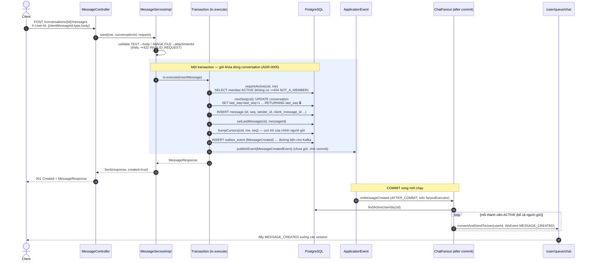
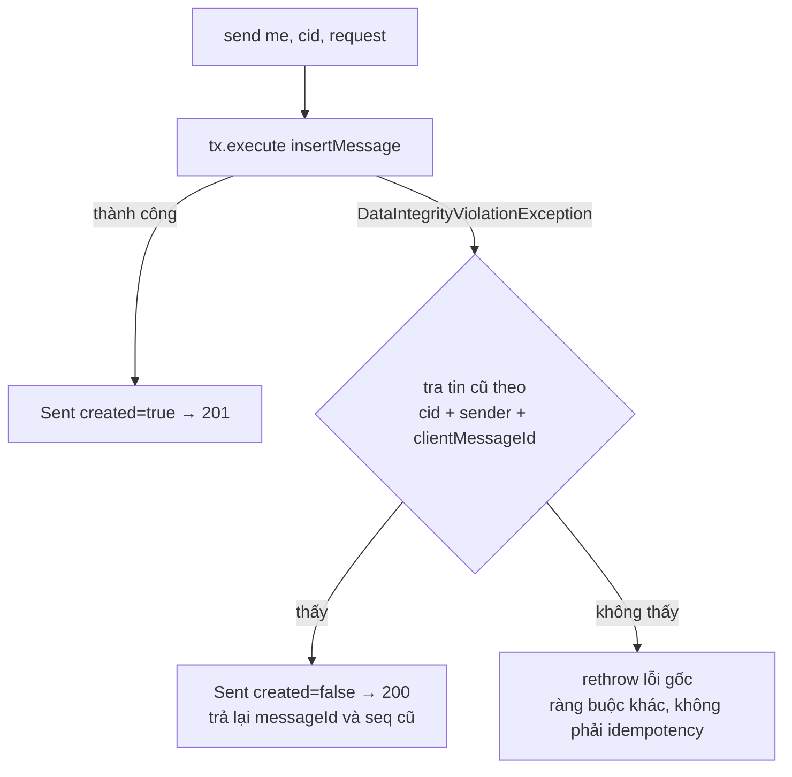
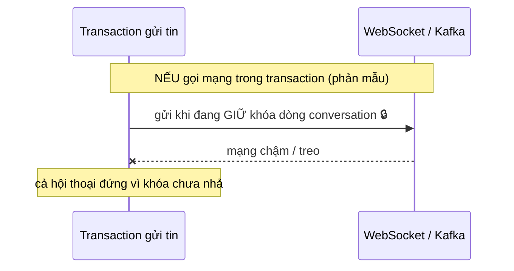

# Luồng gửi tin nhắn — cách chạy và ăn khớp giữa các lớp

Tài liệu mô tả đúng theo code hiện tại: `MessageController` → `MessageService`/`MessageServiceImpl`
→ repository + outbox → (sau commit) `ChatFanout` → WebSocket. Mọi quyết định nền tảng bám hai bất biến:

- **Không gọi mạng / không publish Kafka trong transaction gửi tin** — transaction giữ khóa dòng `conversation` (ADR-0005).
- **Fan-out không giả định một instance** — đẩy qua `/user/queue/chat`, không đếm session toàn hệ thống (ADR-0004).

---

## 1. Bức tranh tổng thể các lớp

```mermaid
flowchart LR
    client([Client])

    subgraph controller
        MC[MessageController\nPOST /conversations/id/messages]
    end
    subgraph service
        MS[MessageServiceImpl.send]
    end
    subgraph repository
        CR[(ConversationRepository)]
        MR[(MessageRepository)]
        CMR[(ConversationMemberRepository)]
        OR[(OutboxEventRepository)]
    end
    subgraph messaging
        CF[ChatFanout\n@TransactionalEventListener]
    end
    DB[(PostgreSQL)]
    WS{{SimpleBroker\n/user/queue/chat}}

    client -->|REST + X-User-Id| MC
    MC -->|gọi interface| MS
    MS --> CR & MR & CMR & OR
    CR & MR & CMR & OR --> DB
    MS -. publishEvent sau commit .-> CF
    CF -->|convertAndSendToUser| WS
    WS -->|đẩy xuống| client
```

Chiều phụ thuộc một chiều: `controller → service → repository → domain`; `messaging` chỉ **nghe event** rồi
gọi repository, không mở transaction nghiệp vụ. Controller mỏng: nhận request, gọi đúng một method service, trả DTO.

---

## 2. Luồng chạy chi tiết (happy path)



### Giải thích từng bước nghiệp vụ

1. **Validate hình thức** ở biên bằng `@Valid` (controller) + kiểm "TEXT phải có body / IMAGE-FILE phải có attachmentId"
   ở đầu service. Sai ⇒ `422`.
2. **`requireActive`**: phải là thành viên `ACTIVE` mới gửi được. Không phải ⇒ `404` (không phân biệt "không tồn tại"
   với "không phải thành viên", tránh lộ thông tin).
3. **`nextSeq`** cấp `seq` bằng `UPDATE ... RETURNING` — đây là **điểm khóa dòng `conversation`**, giữ tới hết
   transaction. Nhờ vậy `seq` **liên tục, không hở** trong một hội thoại (client dựa vào tính chất này để phát hiện thiếu tin).
4. **INSERT message** đi bằng native query để không bị `merge()` chèn thêm một `SELECT`.
5. **`setLastMessage` + `bumpCursors`**: cập nhật con trỏ tin cuối của hội thoại và kéo `last_delivered/last_read`
   của **chính người gửi** (đã gửi thì coi như đã đọc tới đó).
6. **Ghi `outbox_event`**: việc-sau-commit (phát Kafka về sau) nằm trong cùng transaction với dữ liệu → đảm bảo
   tính nhất quán "có tin thì có event". **Không publish Kafka trong transaction.**
7. **`publishEvent`**: chỉ đăng ký một Spring event; `ChatFanout` lắng nghe với `AFTER_COMMIT` nên **chỉ chạy sau khi
   commit thành công**, và chạy trên `fanoutExecutor` (bounded queue + `CallerRunsPolicy`) để có backpressure.

---

## 3. Idempotency — gửi lại cùng `clientMessageId`

`send()` **cố ý không** gắn `@Transactional`: transaction ghi tin và transaction đọc-lại tin cũ là **hai transaction
riêng**. Vì một vi phạm UNIQUE sẽ *abort* transaction ghi, nên việc `SELECT` tin cũ phải nằm **ngoài** nó.



- Chặn trùng dựa vào DB: `UNIQUE (conversation_id, sender_id, client_message_id)` — **không** SELECT-rồi-INSERT ở Java.
- Rollback trọn vẹn của transaction ghi cũng **hủy luôn `last_seq+1`**, nên seq không bị hở khi một lần gửi trùng bị bỏ.
- Lần đầu `201`; gửi lại cùng `clientMessageId` ⇒ `200` với **đúng** `messageId`/`seq` cũ.

> Lưu ý: từ khi có FK `sender_id → app_user`, một `DataIntegrityViolationException` về lý thuyết có thể do vi phạm FK.
> Nhưng `requireActive()` đã bảo đảm có dòng `conversation_member` (kéo theo `app_user`) trước khi INSERT, nên ở
> nhánh catch này chỉ còn khả năng trùng idempotency (đã chú thích trong code).

---

## 4. Vì sao fan-out đặt sau commit, không nằm trong transaction



Đổi lại, kiến trúc hiện tại tách đôi:

- **Đường bền**: `outbox_event` (ghi trong transaction) → publisher/Kafka lo về sau. Chắc chắn xảy ra.
- **Đường nhanh (shortcut hiện tại)**: `ChatFanout` nghe `AFTER_COMMIT`, đẩy thẳng qua `SimpleBroker`.
  Nếu fan-out lỗi thì **nuốt lỗi + log WARN** — tin đã commit, client sẽ **lấy bù qua REST** (`GET .../messages?afterSeq=`).

`READ_UPDATED` (đánh dấu đã đọc) đi cùng cơ chế nhưng chỉ đẩy tới các session của **chính người đọc**.

---

## 5. Bảng tóm tắt trách nhiệm

| Lớp | Trong luồng gửi tin | Không làm |
|---|---|---|
| `MessageController` | Nhận REST, đọc `X-User-Id` (UUID), `@Valid`, gọi `service.send`, map 201/200, log 1 dòng ở biên | Không `if` nghiệp vụ, không transaction, không gọi repo |
| `MessageServiceImpl` | Nghiệp vụ: validate, membership, cấp seq, insert, outbox, publishEvent; quản lý 2 transaction (ghi / tra trùng) | Không biết HTTP, không gọi mạng/Kafka trong tx |
| `repository` | `nextSeq` (UPDATE…RETURNING), `insert`, `setLastMessage`, `bumpCursors`, truy vấn tin cũ | Không logic, không transaction |
| `OutboxEvent` + bảng `outbox_event` | Ghi ý định "đã tạo tin" để phát về sau | — |
| `ChatFanout` (messaging) | Sau commit: tìm thành viên ACTIVE, đẩy `MESSAGE_CREATED` qua WebSocket | Không nghiệp vụ, không mở transaction |

---

## 6. Trạng thái tin suy ra từ con trỏ (không có cột `status` trên `message`)

- **SENT** = dòng `message` tồn tại (đã commit, đã có `seq`).
- **DELIVERED** = `MIN(last_delivered_seq)` của các thành viên ACTIVE khác người gửi `>= seq`.
- **READ** = `MIN(last_read_seq)` của các thành viên ACTIVE khác người gửi `>= seq`.

Nhờ vậy gửi tin chỉ tốn `O(1)` (bump con trỏ người gửi), không phải UPDATE một dòng cho mỗi người nhận.
